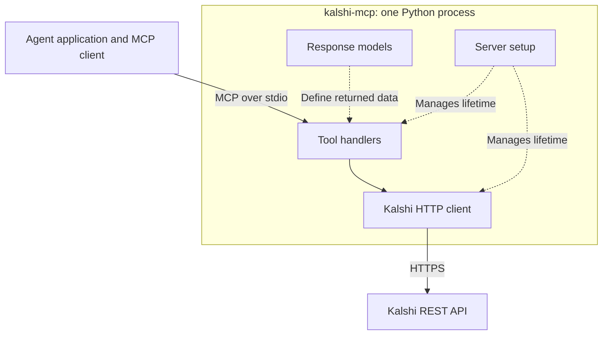

# kalshi-mcp

A local Python MCP server that lets trading agents find Kalshi markets, read contract rules, check order books, and retrieve settlement data.

This is an independent project, not an official Kalshi product.

The server supplies exchange information. The agent handles research, forecasts, trading decisions, paper accounting, and risk limits.

## Architecture

The server runs as one Python process. An agent application connects over MCP, and tool handlers retrieve data from Kalshi's REST API.

| Component | Responsibility |
| --- | --- |
| Server setup | Register tools, start stdio transport, and manage the shared HTTP client's lifetime |
| Tool handlers | Validate arguments, enforce response bounds, and shape results |
| Kalshi client | Call fixed API routes, resolve historical lookups, and handle timeouts and bounded retries |
| Response models | Define returned fields, units, missing-value behavior, and coverage information |

The server uses the [official Python MCP SDK](https://github.com/modelcontextprotocol/python-sdk) for protocol handling and [HTTPX](https://www.python-httpx.org/) for asynchronous HTTP requests and connection reuse.

### Request flow

For `get_market(ticker)`:

1. The MCP client invokes the tool with a market identifier.
2. The handler validates the input and delegates retrieval to the Kalshi client.
3. The Kalshi client retrieves the market from current or historical storage.
4. The handler returns contract details, available settlement fields, retrieval time, and the data source.

With stdio, the client launches the server as a subprocess. Protocol messages use stdin and stdout; logs use stderr. This follows the [MCP transport specification](https://modelcontextprotocol.io/specification/2025-06-18/basic/transports).

## Architectural decisions and tradeoffs

| Decision | Rationale | Tradeoff |
| --- | --- | --- |
| One custom server calling Kalshi REST directly | Keeps discovery, inspection, books, and settlement fields consistent for systematic use | We own API compatibility, response handling, and tests |
| Official MCP SDK plus a small HTTPX client | Reuses the protocol implementation while limiting our API code to required endpoints | We maintain endpoint mappings rather than relying on a broad generated Kalshi client |
| Local stdio transport | Fits a client-launched process without operating a network server | Remote or shared deployment would need additional transport and access-control work |
| Focused tools, bounded order-book batches | Keeps tools focused and limits how much each call fetches | Some workflows require multiple calls rather than one combined discovery operation |
| Automatic historical lookup in `get_market` | Callers can inspect a known contract without understanding Kalshi's storage split | Lookup may require additional requests; routing and failures need testing |
| Caller-controlled pagination | Lets the agent decide how many pages to fetch | The agent must track pagination and request each page |
| No persistent storage or cache | Keeps freshness behavior clear and removes database operations from this package | Repeated reads use network requests; snapshots and history must be stored by the consumer |
| Strategy and paper accounting stay in the consumer | Keeps the server reusable across market categories and agents | Consumers must implement their own forecasts, account state, and risk controls |

Independent requests run with bounded concurrency. Retries are limited to appropriate temporary read failures and respect rate-limit responses.

### Why not use the official Kalshi MCP?

[Kalshi's official hosted connector](https://docs.kalshi.com/getting_started/mcp) supports interactive market research. In a small evaluation on November 8, 2026, its tool descriptions discouraged systematic scans, and inspected settled-market responses omitted payout values and settlement timestamps available through REST. Direct REST access gives this project explicit discovery filters and settlement fields through one interface, at the cost of maintaining API compatibility. The official connector is not a runtime dependency.

## Tools

Kalshi organizes contracts into **series** (recurring event types), **events** (particular occurrences), and **markets** (tradable outcomes). A ticker is the identifier used to retrieve one of these resources.

| Tool | Responsibility |
| --- | --- |
| `list_series` | Discover series using supported category and tag filters |
| `get_series` | Inspect a series, its contract references, settlement sources, and available fee metadata |
| `list_events` | Discover events using supported filters and pagination |
| `get_event` | Inspect a known event and its parent-series context without scanning listings |
| `list_markets` | Retrieve compact market summaries using supported identifiers, status, and time filters |
| `get_market` | Retrieve relevant contract details, prices, status, and available settlement fields, including historical lookup |
| `get_orderbooks` | Retrieve order-book depth for a bounded batch of market tickers |

Filter combinations and pagination depend on the underlying API endpoint. Not every listing endpoint supports cursor pagination.

A client can explore series and events before selecting markets, or go directly to `get_market` and `get_orderbooks` when it already knows the tickers.

## Data guarantees and limitations

- Listings return compact records and identify whether results are incomplete. Detail tools preserve relevant rule text.
- Monetary values and contract quantities keep the API's decimal strings to avoid rounding. Missing values remain distinct from zero.
- Retrieval timestamps are separate from exchange timestamps. Fetching a response now does not prove its quotes were updated now.
- Invalid input, missing resources, rate limiting, upstream failures, and malformed responses remain distinguishable. A failed book request must not look like an empty book.
- Listing calls do not recursively scan child resources or automatically consume every page. Responses identify truncation and whether more results are available, including where native pagination is unavailable.
- Batch results preserve partial success when the upstream response supports it. A request-wide failure remains a request-wide error.
- `get_market` automatically resolves current versus historical storage using bounded requests and identifies the source. Temporary API failures must not be treated as evidence that a market was archived.
- Responses include prices. A consuming application that requires independent forecasts must isolate price information from its forecasting step.

- Order books describe observed liquidity, not guaranteed fills.
- Series fee metadata is not necessarily a complete fee quote because event overrides can apply.
- A closed market may still be waiting for settlement. Use the actual payout value for settlement accounting rather than deriving it from a YES/NO label.

## Scope and exclusions

The server provides read-only exchange data. It does not include:

- Live order placement, cancellation, or authenticated portfolio management.
- Paper fills, account balances, positions, reserve policies, or performance accounting.
- Market selection, research, forecasts, opportunity ranking, or position sizing.
- Combo construction, RFQ workflows, perpetual futures, price alerts, and price-history analysis.
- Execution-cost estimates, a persistent database, caching, and background workers.

## API references

- [Market listing and supported filters](https://docs.kalshi.com/api-reference/market/get-markets)
- [Market details](https://docs.kalshi.com/api-reference/market/get-market)
- [Order-book representation](https://docs.kalshi.com/getting_started/orderbook_responses)
- [Batch order books](https://docs.kalshi.com/api-reference/market/get-multiple-market-orderbooks)
- [Historical data routing](https://docs.kalshi.com/getting_started/historical_data)
- [Event fee overrides](https://docs.kalshi.com/api-reference/events/get-event-fee-changes)
- [Kalshi SDK and API specification guidance](https://docs.kalshi.com/sdks/overview)
