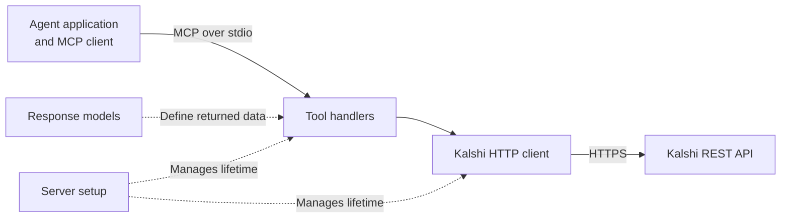

# kalshi-mcp

A local Python MCP server that lets trading agents find Kalshi markets, read contract rules, check order books, and retrieve settlement data.

## Tools

Kalshi groups markets into **series** (recurring event types) and **events** (specific occurrences). Each series, event, and market has a ticker used to look it up. For definitions of these terms, see [Key terms](#key-terms).

| Tool | What it does |
| --- | --- |
| `list_series` | Find series by category and tags |
| `get_series` | Read contract references, settlement sources, and available fee metadata |
| `list_events` | Find events using filters and pagination |
| `get_event` | Read an event and its parent-series context |
| `list_markets` | Get market summaries filtered by identifiers, status, and time |
| `get_market` | Read contract rules, prices, status, and available settlement fields, including archived markets |
| `get_orderbooks` | Get order-book depth for a limited batch of market tickers |

Filters and pagination vary by endpoint. Listing calls return one page at a time where pagination is supported. If you already know the tickers, go straight to `get_market` and `get_orderbooks`.

## Architecture

The server runs as one Python process. An agent application connects over MCP, and tool handlers retrieve data from Kalshi's REST API.



| Component | Responsibility |
| --- | --- |
| Server setup | Register tools, start stdio transport, and manage the shared HTTP client's lifetime |
| Tool handlers | Validate arguments, enforce response bounds, and shape results |
| Kalshi client | Call fixed API routes, resolve historical lookups, and handle timeouts and bounded retries |
| Response models | Define returned fields, units, missing-value behavior, and coverage information |

The server uses the [official Python MCP SDK](https://github.com/modelcontextprotocol/python-sdk) for protocol handling and [HTTPX](https://www.python-httpx.org/) for asynchronous HTTP requests and connection reuse.

### Design choices

| Choice | Why | Tradeoff |
| --- | --- | --- |
| Direct Kalshi REST access | Gives all tools the same API client and access to the fields they need | We maintain compatibility with Kalshi's API |
| Local stdio | Runs as a subprocess without hosting a server | No remote or shared deployment |
| No database or cache | Reads from Kalshi on each call, with no storage to set up | Repeated calls use the network; the agent must save any history it needs |

Concurrent requests and retries are capped. Only temporary read failures are retried, with rate limits respected.

## Data handling

- Monetary values and quantities retain decimal strings. Missing values are separate from zero.
- Retrieval time and exchange timestamps are separate. A new response can contain older quotes.
- Errors are distinct from empty results. Batches retain successful results where supported and report failures.
- Order books show available liquidity, without guaranteeing fills. Series fees may have event-specific overrides.
- Closed markets may still await settlement. Use the actual payout value for accounting.

## Scope and exclusions

Read-only market data. No trading or portfolio access. Combo/RFQ workflows, perpetual futures, and price-history tools are outside the scope.

## Setup

### 1. Install

Requires Python 3.13 or later and [uv](https://docs.astral.sh/uv/getting-started/installation/). No Kalshi credentials are required.

```sh
git clone https://github.com/samarv1/kalshi-mcp.git
cd kalshi-mcp
uv sync --locked --python 3.13
```

### 2. Connect your client

Choose one option below. Replace placeholder paths with absolute paths on your machine. Your client starts the server automatically.

On macOS/Linux, use `command -v uv` for the executable path and `pwd` from this repository for its path.

<details>
<summary>Codex</summary>

With the [Codex CLI](https://learn.chatgpt.com/docs/extend/mcp?surface=cli) installed:

```sh
codex mcp add kalshi -- "/absolute/path/to/uv" --directory "/absolute/path/to/kalshi-mcp" run --locked kalshi-mcp
```

Fully quit and reopen Codex desktop to load it.

</details>

<details>
<summary>Claude Code</summary>

With [Claude Code](https://code.claude.com/docs/en/mcp) installed:

```sh
claude mcp add --transport stdio --scope user kalshi -- "/absolute/path/to/uv" --directory "/absolute/path/to/kalshi-mcp" run --locked kalshi-mcp
```

</details>

<details>
<summary>Claude Desktop, Cursor, and other clients</summary>

- [Claude Desktop](https://modelcontextprotocol.io/docs/develop/connect-local-servers): Settings → Developer → Edit Config.
- [Cursor](https://cursor.com/docs/mcp): open `~/.cursor/mcp.json`.

Merge this configuration, preserving existing servers:

```json
{
  "mcpServers": {
    "kalshi": {
      "command": "/absolute/path/to/uv",
      "args": [
        "--directory", "/absolute/path/to/kalshi-mcp",
        "run", "--locked", "kalshi-mcp"
      ]
    }
  }
}
```

Save, then fully quit and reopen Claude Desktop.

For another client with local stdio support, use the same command and arguments in its configuration format.

</details>

### 3. Try it

Reload your client, then ask:

> Use Kalshi to find one open market and show its rules and order book.

## Testing

Run offline tests:

```sh
uv run --locked pytest -q
```

Run the opt-in live check on macOS or Linux:

```sh
KALSHI_LIVE_TEST=1 uv run --locked pytest tests/test_live.py -q -s
```

The live check exercises all seven tools against Kalshi. It can fail if the network or sample data is unavailable.

## API references

- [Market listing and supported filters](https://docs.kalshi.com/api-reference/market/get-markets)
- [Market details](https://docs.kalshi.com/api-reference/market/get-market)
- [Order-book representation](https://docs.kalshi.com/getting_started/orderbook_responses)
- [Batch order books](https://docs.kalshi.com/api-reference/market/get-multiple-market-orderbooks)
- [Historical data routing](https://docs.kalshi.com/getting_started/historical_data)
- [Event fee overrides](https://docs.kalshi.com/api-reference/events/get-event-fee-changes)
- [Kalshi SDK and API specification guidance](https://docs.kalshi.com/sdks/overview)

## Key terms

<details>
<summary>Definitions</summary>

| Term | Meaning |
| --- | --- |
| **Series** | A group of events that share a contract structure and rules, such as monthly inflation reports. |
| **Event** | A specific occurrence, such as November's inflation report. |
| **Market** | A specific question within an event, such as whether inflation exceeds 3%. |
| **Contract** | A tradable unit whose final payout depends on the market's outcome. |
| **YES / NO** | The two sides of a binary market. YES corresponds to the stated condition occurring. NO corresponds to it failing to occur. |
| **Ticker** | The unique identifier used to look up a series, event, or market. |
| **Bid / ask** | A bid is a price someone offers to pay. An ask is a price someone offers to sell for. |
| **Order book** | The waiting buy or sell orders, grouped by price and quantity. Kalshi's API represents these using YES and NO bids. |
| **Liquidity** | The quantity available to trade at different prices. |
| **Settlement** | The exchange finalizes the market's result and payout. Closing trading and settling can happen at different times. |
| **Fee** | A charge for trading. Series fee metadata describes defaults, and event-specific rules can override them. |

</details>
