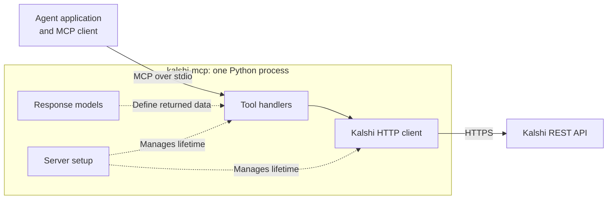

# kalshi-mcp

A local Python MCP server that lets trading agents find Kalshi markets, read contract rules, check order books, and retrieve settlement data.

This is an independent project, not an official Kalshi product.

The server supplies exchange information. The agent handles research, forecasts, trading decisions, paper accounting, and risk limits.

## Setup

TBD.

## Tools

Kalshi groups markets into **series** (recurring event types) and **events** (specific occurrences). Each series, event, and market has a ticker used to look it up.

| Tool | What it does |
| --- | --- |
| `list_series` | Find series by category and tags |
| `get_series` | Read contract references, settlement sources, and available fee metadata |
| `list_events` | Find events using filters and pagination |
| `get_event` | Read an event and its parent-series context |
| `list_markets` | Get market summaries filtered by identifiers, status, and time |
| `get_market` | Read contract rules, prices, status, and available settlement fields, including archived markets |
| `get_orderbooks` | Get order-book depth for a limited batch of market tickers |

Filters and pagination vary by endpoint. Listing calls return one page at a time where pagination is supported. If you already know the tickers, go straight to `get_market` and `get_orderbooks`.

## Architecture

The server runs as one Python process. An agent application connects over MCP, and tool handlers retrieve data from Kalshi's REST API.

| Component | Responsibility |
| --- | --- |
| Server setup | Register tools, start stdio transport, and manage the shared HTTP client's lifetime |
| Tool handlers | Validate arguments, enforce response bounds, and shape results |
| Kalshi client | Call fixed API routes, resolve historical lookups, and handle timeouts and bounded retries |
| Response models | Define returned fields, units, missing-value behavior, and coverage information |

The server uses the [official Python MCP SDK](https://github.com/modelcontextprotocol/python-sdk) for protocol handling and [HTTPX](https://www.python-httpx.org/) for asynchronous HTTP requests and connection reuse.

With stdio, the client launches the server as a subprocess. Protocol messages use stdin and stdout; logs use stderr. This follows the [MCP transport specification](https://modelcontextprotocol.io/specification/2025-06-18/basic/transports).

### Design choices

| Choice | Why | Tradeoff |
| --- | --- | --- |
| Direct Kalshi REST access | Gives all tools the same API client and access to the fields they need | We maintain compatibility with Kalshi's API |
| Local stdio | Runs as a subprocess without hosting a server | No remote or shared deployment |
| No database or cache | Reads from Kalshi on each call, with no storage to set up | Repeated calls use the network; the agent must save any history it needs |

Concurrent requests and retries are capped. Only temporary read failures are retried, with rate limits respected.

### Why not use the official Kalshi MCP?

As of Nov 8, 2026, [Kalshi's official MCP](https://docs.kalshi.com/getting_started/mcp) discourages systematic scans in its tool descriptions. The settled-market responses we checked also omitted payout values and settlement timestamps. This server uses REST directly for discovery filters and settlement fields, without depending on the official MCP.

## Data guarantees and limitations

- Listings return compact records and identify whether results are incomplete. Detail tools preserve relevant rule text.
- Monetary values and contract quantities keep the API's decimal strings to avoid rounding. Missing values remain distinct from zero.
- Retrieval timestamps are separate from exchange timestamps. Fetching a response now does not prove its quotes were updated now.
- Invalid input, missing resources, rate limiting, upstream failures, and malformed responses remain distinguishable. A failed book request must not look like an empty book.
- Listing calls do not recursively scan child resources or automatically consume every page. Responses identify truncation and whether more results are available, including where native pagination is unavailable.
- Batch results preserve partial success when the upstream response supports it. A request-wide failure remains a request-wide error.
- `get_market` automatically resolves current versus historical storage using bounded requests and identifies the source. Temporary API failures must not be treated as evidence that a market was archived.
- Responses include prices. Agents that need independent forecasts should keep prices out of the forecasting step.
- Order books describe observed liquidity, not guaranteed fills.
- Series fee metadata is not necessarily a complete fee quote because event overrides can apply.
- A closed market may still be waiting for settlement. Use the actual payout value for settlement accounting rather than deriving it from a YES/NO label.

## Scope and exclusions

The server provides read-only exchange data. It does not include:

- Live order placement, cancellation, or authenticated portfolio management.
- Paper fills, account balances, positions, reserve policies, or performance accounting.
- Market selection, research, forecasts, opportunity ranking, or position sizing.
- Combo construction, RFQ workflows, perpetual futures, price alerts, and price-history analysis.
- Execution-cost estimates, a persistent database, caching, and background workers.

## API references

- [Market listing and supported filters](https://docs.kalshi.com/api-reference/market/get-markets)
- [Market details](https://docs.kalshi.com/api-reference/market/get-market)
- [Order-book representation](https://docs.kalshi.com/getting_started/orderbook_responses)
- [Batch order books](https://docs.kalshi.com/api-reference/market/get-multiple-market-orderbooks)
- [Historical data routing](https://docs.kalshi.com/getting_started/historical_data)
- [Event fee overrides](https://docs.kalshi.com/api-reference/events/get-event-fee-changes)
- [Kalshi SDK and API specification guidance](https://docs.kalshi.com/sdks/overview)
